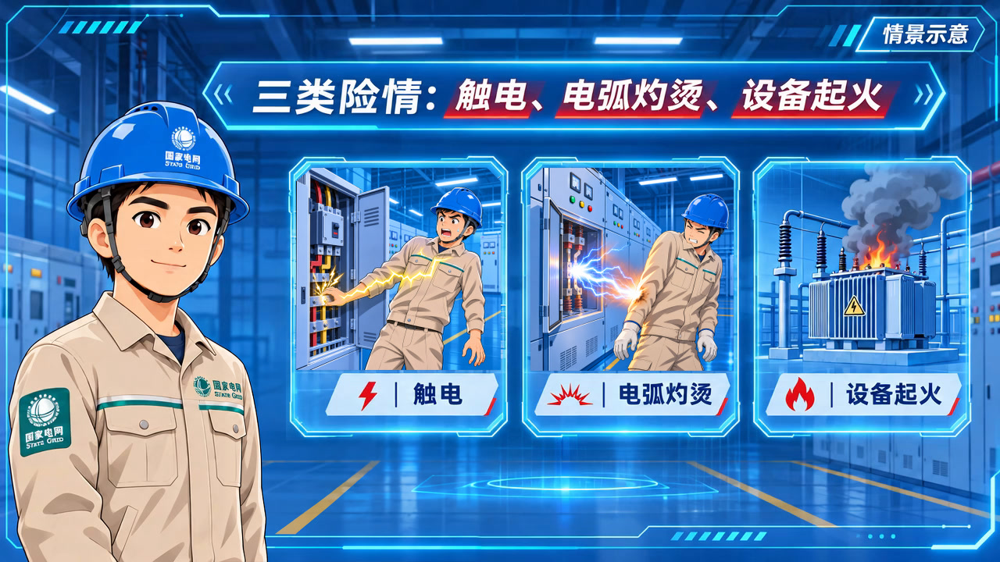

# 三类险情视频调整版（8.mp4）

[下载修改后视频](./electrical_hazards_refined_20261113.mp4)

- 讲解人物手臂自然下垂，去掉原有抬手介绍动作，面部与口型保留原片变化。
- “触电”画窗改为人物接触带电设备、遭受电击的安全警示插图。
- “电弧灼烫”画窗改为电弧跨空气间隙作用于人物、表现热灼伤风险的安全警示插图，无血腥内容。
- 原标题、标签、科技边框、第三格设备起火画面及原声保留。原手臂遮挡的局部背景已补全。
- 1280×720，16:9，24fps，145帧，约6.04秒。MP4 / H.264 / AAC。
- 完成全片解码、关键帧、图框贴合、原音轨一致性及浏览器播放检查。

SHA-256：`a29fc0c24dacdae4376faea1db5ad9d87aa66a9540c3379895aedee51e4d4c7a`
